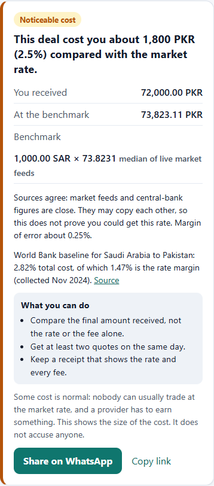
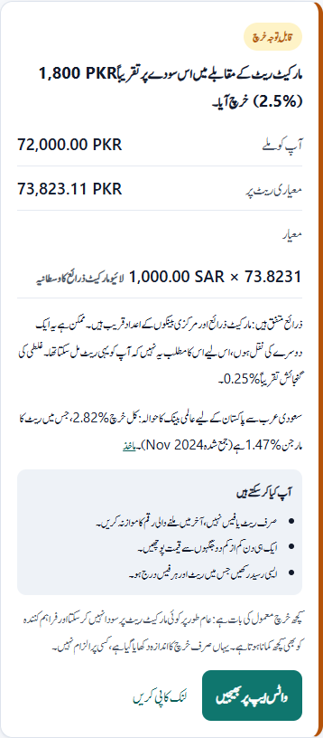

# TrueRate

**What did your currency deal really cost you?**

Enter what you gave and what you received. TrueRate shows the cost against the market rate that day, in your own money, with every source shown. Your amounts never leave your device. Free, no sign-up, in English and Urdu.

**[Try it: truerate.hassan-memon.workers.dev](https://truerate.hassan-memon.workers.dev)** · [اردو میں](https://truerate.hassan-memon.workers.dev/ur)

[](https://github.com/Hassan-Memon/truerate/actions/workflows/ci.yml) [](https://github.com/Hassan-Memon/truerate/actions/workflows/deploy.yml) [](LICENSE)

<p>
  
  
</p>

## The problem

People changing money usually see a rate and a fee, but rarely what the deal cost them in total. A fee-free transfer can hide its cost in the rate, and every website shows a different number for the dollar. That is mostly because there is a chain of prices, not one price. USD/PKR on 4 November 2026:

| Step | Publisher | Buy | Sell |
|---|---|---|---|
| Interbank, where banks trade | State Bank of Pakistan | 276.70 | |
| Banks to customers | State Bank of Pakistan | 276.39 | 276.85 |
| Open market, cash | Exchange Companies Association of Pakistan | 277.35 | 278.48 |

Details and sources are in [`docs/research.md`](docs/research.md).

## What it does

- **Check a deal you already did.** Amount given, any fee, amount received, date and channel. You get the cost in your own money, the benchmark used and its margin of error.
- **Check a quote before you agree.** Enter a quote to see what it would cost. Leave the amount received empty to see what to expect, and the marks for a fair and a costly quote.
- **See the rate ladder** for USD/PKR, with each step's publisher, method in their own words and a link to the original document.
- **See who decides the rate:** floating, managed, peg or band, with a citation and the market's distance from any peg.
- **Share on WhatsApp.** The message contains only what the page shows you before you send it, never your amounts.
- **Use it in Urdu.** Urdu pages are real pages at `/ur`, with the language and text in the HTML.

## It refuses to guess

A confident wrong number does more harm than no number, so TrueRate declines when it can't support an answer:

| Situation | What you see |
|---|---|
| Feeds split into separate groups (USD/SYP: 122 and 13,003) | No rate, because the midpoint is a number nobody reported |
| Feeds agree with each other but sit over 20% from central banks | No rate, for the same reason |
| Documented as having more than one rate (Myanmar, Venezuela, Iran, Ethiopia, Syria) | No verdict, with the reason and a citation |
| Your difference is inside a wide margin of error | "Too uncertain to judge", never "about the market rate" |
| A cash deal | The difference from mid-market and no verdict, because dealers publish their own prices on either side of it |
| A likely typing mistake | A request to check the numbers |

"Sources agree" only ever means that: feeds can copy each other, so agreement doesn't prove anyone can get that rate.

Verdict bands are under 1% close to market, 1–3% noticeable, 3% or more high, and 25% or more very high. They are our judgement. The 3% mark is the [UN's target](https://sdgs.un.org/goals/goal10) for the cost of sending money home. "Some cost is normal" appears beside every verdict: this measures cost, it does not accuse anyone.

## Privacy

Your browser asks the server for one thing: the benchmark for a currency pair and a date. It then does the arithmetic itself in [`public/check.js`](public/check.js), and a test checks that the deal request carries no amounts. There are no accounts, no cookies and no analytics, and nothing is stored.

## Data sources

| Tier | Source | Licence or terms | Notes |
|---|---|---|---|
| Market | [Currency-API](https://github.com/fawazahmed0/exchange-api) | CC0 | daily |
| Market | [FloatRates](https://www.floatrates.com/json-feeds.html) | Free public feeds; no written terms found | twice a day |
| Central banks | [Frankfurter](https://frankfurter.dev/) | MIT code; each provider's data terms apply | about 100 institutions, also used for past dates |
| Hand-entered | [State Bank of Pakistan](https://www.sbp.org.pk/economic-data) and ECAP documents, in [`ladders.json`](src/core/ladders.json) | Public documents | dated, each row linked to its original |
| Hand-entered | Cited regime facts, in [`regimes.json`](src/core/regimes.json) | | each with a source and the date checked |

**Check a feed's terms before adding it.** This site offers an open API, so feeds that forbid redistribution can't be used. ExchangeRate-API's open endpoint and MoneyConvert both forbid it, and were removed for that reason.

## Current limits

- **Benchmarks are mid-market figures.** They are good enough to spot a cost of 1–4%, but they are not prices anyone can trade at, and our feeds update daily rather than live.
- **The ladder is hand-entered and covers only USD/PKR.** It shows its age. SBP's site refuses scripted requests and we do not work around that.
- **"Typical cost" is rarely available.** It appears only where a figure can be cited: the World Bank's Saudi Arabia to Pakistan baseline from November 2024, and the ladder.
- **The multi-rate list is short and hand-kept,** so a missing currency isn't proven to have one rate.
- **There is no provider comparison** and no advice on which provider to use.
- **Some explanations stay in English in the Urdu view:** the source-agreement reasons from the server.

## Run locally

Requires Node 22+.

```bash
node src/server.js          # http://localhost:3000
npm test                    # 111 offline tests (node --test), fixtures in test/fixtures/
npm run preview             # same app inside the real Workers runtime (wrangler dev)
npm run sitemap             # regenerate public/sitemap.xml
```

If an upstream is down, the site keeps working: a dead market feed is dropped from the median, and if the central-bank feed is down the page says so and shows market feeds only.

## API

No key needed, and CORS is open. Please cache on your side; responses are good for five minutes.

```
GET /api/benchmark?from=USD&to=PKR&date=2026-11-04   the yardstick for a deal: rate, margin, grade
GET /api/pair?from=USD&to=PKR                        every source and central bank, regime and ladder
GET /api/convert?from=USD&to=PKR&amount=100          result and low/high band (null with no consensus)
GET /api/rates?base=PKR                              all currencies against a base
GET /api/history?from=USD&to=PKR&days=90             daily central-bank history
GET /api/sources  ·  /api/currencies  ·  /api/health
```

## How it is built

No runtime dependencies, no build step and no API keys. It runs on plain Node 22+ or on the Cloudflare Workers free plan, from the same request handler.

```
public/check.js        the deal check, browser only     public/i18n.js        English and Urdu text
public/app.js          the page, no framework           public/               HTML, CSS, sitemap, share image
src/api.js             HTTP routes, runtime neutral     src/core/pages.js     server-rendered pages and SEO
src/core/benchmark.js  benchmark grade and ladder       src/core/aggregate.js consensus and pair maths
src/core/sources.js    market feeds                     src/core/official.js  central banks
src/core/regimes.json  cited "who decides" facts        src/core/ladders.json hand-entered rate ladder
src/server.js          Node entry                       src/worker.js         Cloudflare Worker entry
```

Built with [Claude Code](https://claude.com/claude-code) as the coding assistant.

## Deploy for free (Cloudflare Workers)

1. Create a free Cloudflare account (no card needed).
2. `npx wrangler@4 login` then `npm run deploy`. You get `https://truerate.<you>.workers.dev`.
3. Or deploy from CI: add `CLOUDFLARE_API_TOKEN` and `CLOUDFLARE_ACCOUNT_ID` as Actions secrets, set the repository variable `DEPLOY_ENABLED=true`, and merge to `master`. See [`docs/security.md`](docs/security.md#cicd) for the token scope.

Any Node host also works: `PORT=8080 node src/server.js`.

## Status (2026-11-09)

Live on the Cloudflare Workers free plan. Every merge to `master` runs the tests and deploys. Demand is still untested: no real users have tried it yet.

Next:
1. **Real receipts.** Collect about 30 from freelancers and people sending money home, to learn the size of the costs and whether people care.
2. **Opt-in contributions,** if people want them: anonymous reports of what each channel really costs, which nobody publishes. This needs storage, a privacy notice and moderation.
3. **Fresh ladder data,** with SAR and AED added: an easier way to enter the day's figures, or SBP's permission to read them automatically. That would also allow real verdicts on cash deals.
4. **A custom domain,** which would do more for search and trust than a `workers.dev` address.

Open:
1. CPU time on the free plan (10 ms per request): building a snapshot is the heaviest step and happens once per five minutes per isolate. Watch it as traffic grows.
2. History and past-date benchmarks rely on Frankfurter alone; when it is down the page says so.

## Contributing

Corrections are welcome, especially cited facts for [`regimes.json`](src/core/regimes.json). `master` takes pull requests only, with green CI, and the rule applies to the maintainer too. Report a wrong number by [opening an issue](https://github.com/Hassan-Memon/truerate/issues).

## Security

The app ships no dependencies, no API keys and no cookies, and every upstream URL is hardcoded. Repository controls are documented with verification commands in [`docs/security.md`](docs/security.md). Report vulnerabilities privately via [`SECURITY.md`](SECURITY.md).

MIT licence. Rates are informational, not financial or religious advice.
